<div align="center">

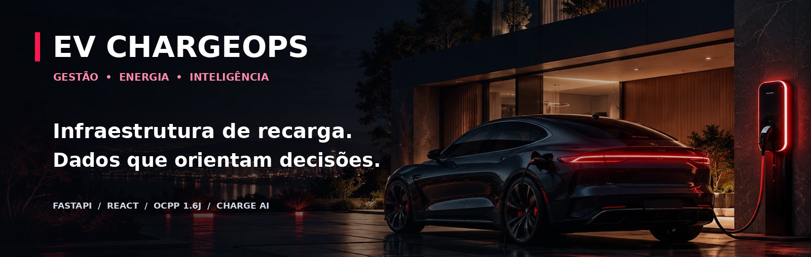

# EV ChargeOps

### Gestão inteligente de infraestrutura de recarga para condomínios

**Carregadores conectados · Consumo e faturamento · Inteligência artificial · Sincronização de dados · OCPP 1.6J**

[](backend/)
[](frontend/)
[](frontend/)
[](docs/OCPP.md)
[](#status-do-projeto)
[](#contexto-do-projeto)

**[Explorar funcionalidades](#funcionalidades-e-demonstrações)** · **[Integração OCPP](docs/OCPP.md)** · **[Soluções sustentáveis](docs/SUSTENTABILIDADE.md)** · **[Executar localmente](#executando-o-projeto)**

</div>

---

## Visão do projeto

O **EV ChargeOps** é uma aplicação acadêmica para organizar a operação de pontos de recarga de veículos elétricos em condomínios. Em vez de manter consumo, disponibilidade, sessões e valores dispersos, a plataforma reúne os dados em uma única experiência de gestão, com acessos específicos para **síndico** e **morador**.

O sistema combina um **frontend em React** com uma **API Python/FastAPI** responsável pelos cálculos, autenticação, regras de negócio, persistência e integração OCPP. O **ChargeAI**, seu copiloto de dados, permite explorar indicadores em linguagem natural sem conceder acesso indiscriminado ao banco ou aos comandos dos equipamentos.

> [!IMPORTANT]
> **Status real da entrega:** o projeto está em estágio de **protótipo acadêmico**. Há dados e operações **simulados**, além de uma implementação **parcial de OCPP 1.6J** para testes de protocolo. Não há homologação documentada com um carregador GoodWe físico nem medição comprovada de redução de carbono. As imagens deste README são **mockups ilustrativos** produzidos para apresentar as funcionalidades; não são capturas autenticadas de um sistema em produção. Os números das imagens são exemplos.

### Qual problema buscamos resolver?

| Desafio | Abordagem do EV ChargeOps |
|---|---|
| Pouca transparência sobre a energia consumida | Consulta de kWh, histórico de recargas e custos vinculados às sessões |
| Controle manual da disponibilidade | Estado dos carregadores centralizado e atualização com eventos do equipamento |
| Dificuldade para atribuir consumo por pessoa | Perfis de moradores, recargas vinculadas e RFID no fluxo OCPP |
| Informações desconectadas entre perfis | Mesma base de dados, APIs autorizadas e atualização automática |
| Gestão reativa | Gráficos, anomalias, perfis de uso e previsões indicativas |
| Necessidade de interoperabilidade | Gateway OCPP 1.6J via WebSocket, com escopo e limitações documentados |

---

<div align="center">

**TOUR VISUAL — TELAS E FUNCIONALIDADES**

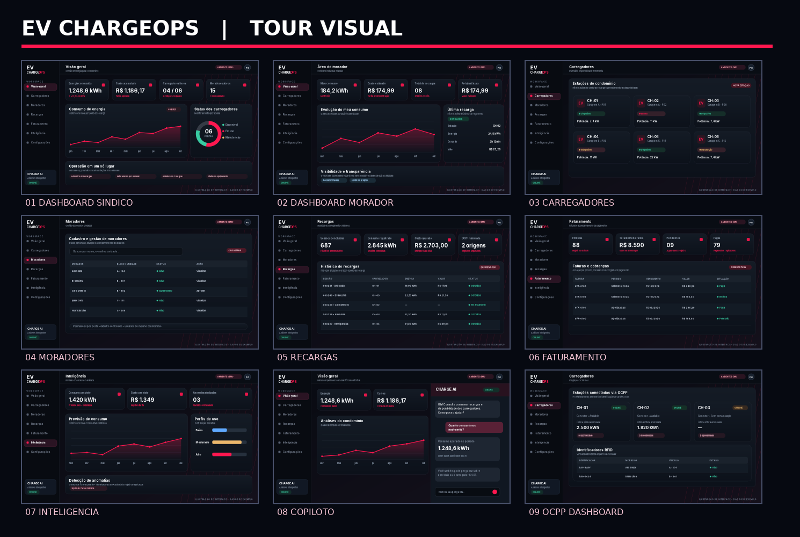

<sub>Mockups ilustrativos para documentação; valores e situações são exemplos.</sub>

</div>

---

## Navegação rápida

- [Experiência visual e login](#01--experiência-visual-e-login)
- [Dashboard do síndico](#02--dashboard-do-síndico)
- [Dashboard do morador](#03--dashboard-do-morador)
- [Carregadores](#04--gestão-de-carregadores)
- [Moradores e permissões](#05--moradores-e-permissões)
- [Recargas e sessões](#06--recargas-e-sessões)
- [Faturas e pagamentos](#07--faturamento-e-cobranças)
- [Análises e previsões](#08--inteligência-e-previsões)
- [Copiloto ChargeAI](#09--copiloto-chargeai)
- [Sincronização](#10--sincronização-entre-perfis)
- [OCPP 1.6J e RFID](#11--ocpp-16j-e-rfid)
- [Sustentabilidade](#12--visão-de-sustentabilidade)
- [Arquitetura](#arquitetura-da-solução)
- [Como executar](#executando-o-projeto)
- [Segurança, testes e limitações](#segurança-testes-e-limitações)

---

## Funcionalidades e demonstrações

### 01 · Experiência visual e login


O ponto de entrada da aplicação apresenta o conceito de mobilidade elétrica em uma interface **dark premium**, com destaque vermelho, arte automotiva e autenticação por e-mail e senha. O backend autentica usuários com **JWT**, enquanto o frontend utiliza o token nas consultas autorizadas.

**Destaques:** identidade visual, interface responsiva, separação de perfis e mensagens de erro de autenticação.

### 02 · Dashboard do síndico

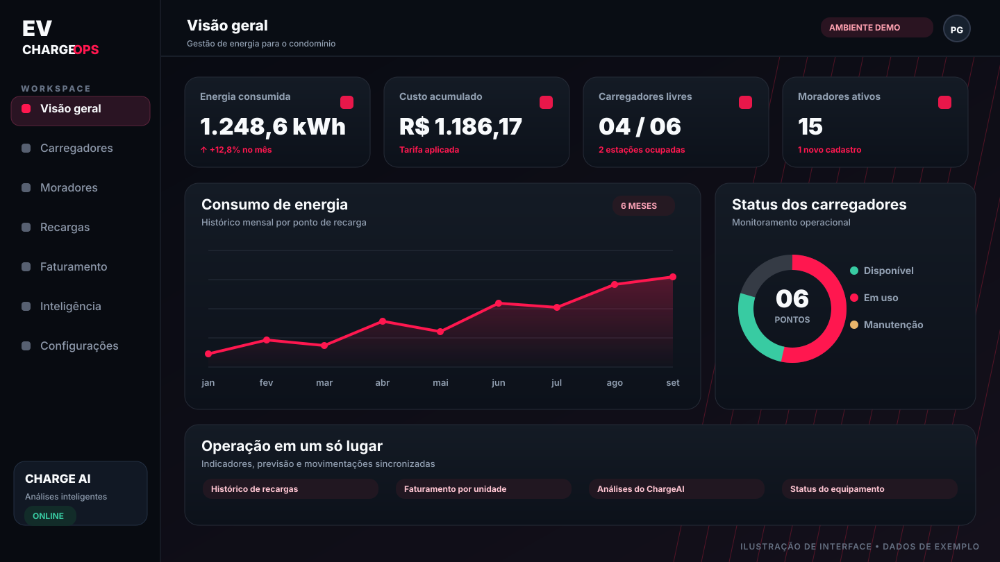

O painel administrativo apresenta uma visão do condomínio: **energia consumida, custo acumulado, número de carregadores, disponibilidade, moradores ativos, gráficos históricos e alertas**. Há consultas por período e análises para apoiar decisões operacionais.

**Fonte no projeto:** `backend/app/api/routes/dashboard.py` e `backend/app/services/dashboard_service.py`.

### 03 · Dashboard do morador

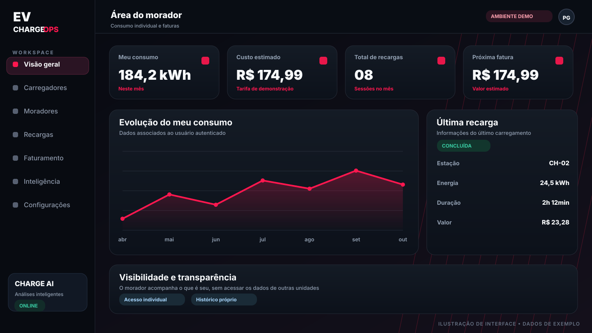

O morador acompanha **somente seus próprios dados**, como consumo, custo no mês, quantidade de sessões, histórico e informações de faturamento. Esse isolamento é aplicado nas **rotas do backend**, não apenas por ocultar campos no navegador.

### 04 · Gestão de carregadores

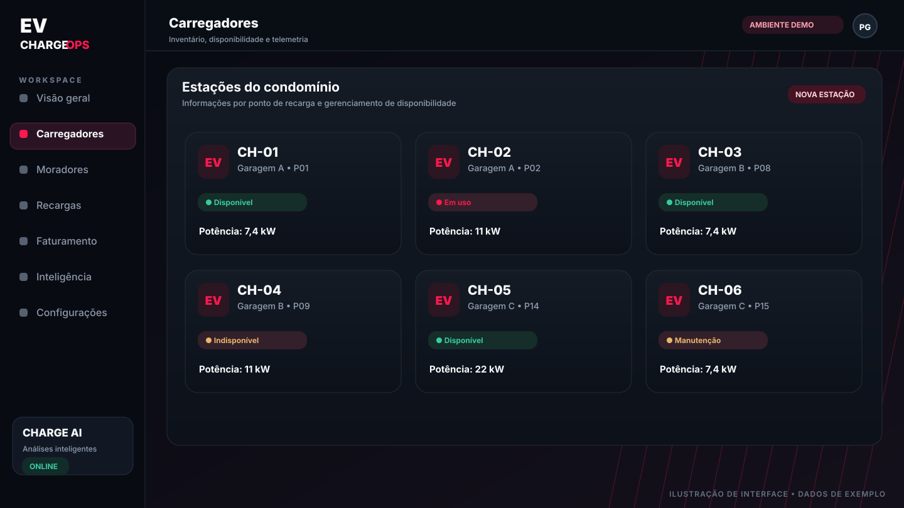

Inventário de equipamentos com código, localização, potência, tipo de conector e situação operacional. O perfil administrativo possui operações de cadastro e gerenciamento; equipamentos OCPP provisionados exibem conexão, status e telemetria quando disponíveis.

**Importante:** carregadores simulados e dispositivos OCPP possuem tratamentos diferentes. O sistema evita iniciar uma sessão fictícia em equipamento gerenciado pelo protocolo.

### 05 · Moradores e permissões

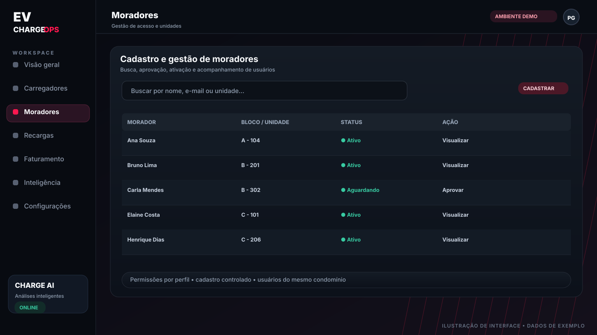

Cadastro de moradores com unidade/bloco, busca, filtros e ações administrativas de aprovação, rejeição, ativação ou desativação. A vinculação de cartões **RFID** complementa o fluxo de autorização no OCPP. O síndico gerencia contas; o morador acessa apenas as informações permitidas à sua identidade.

### 06 · Recargas e sessões

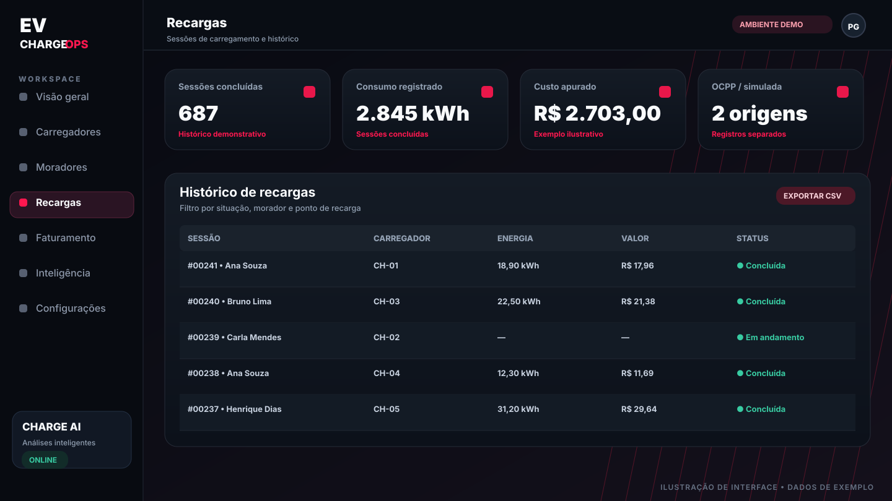

Histórico por sessão, carregador, morador, período, energia em kWh, custo e situação. O sistema oferece **exportação CSV** e, no contexto demonstrativo, ações de início e encerramento de sessões. O fluxo OCPP recebe `StartTransaction`, `MeterValues` e `StopTransaction` para registrar transações vinculadas ao equipamento.

### 07 · Faturamento e cobranças

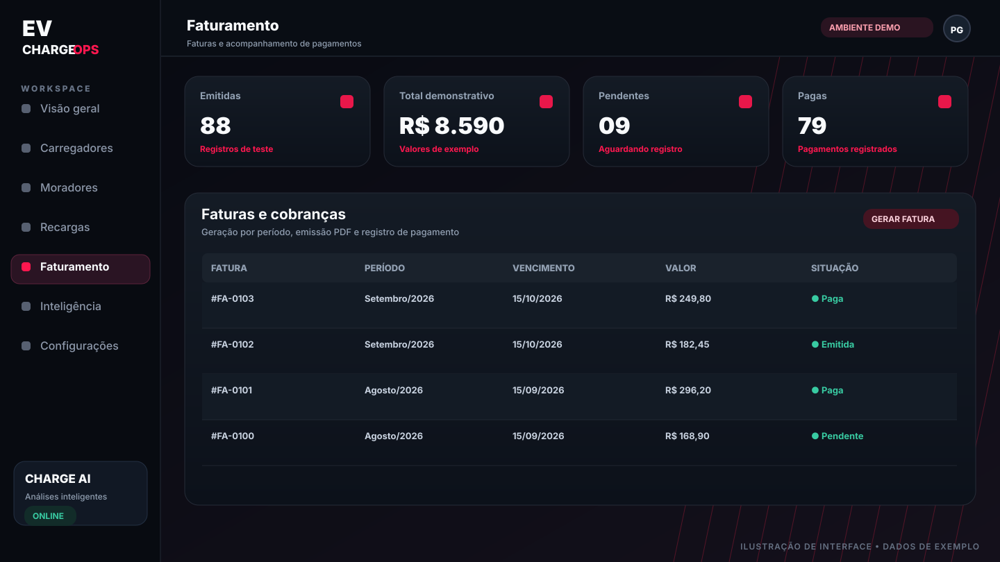

Módulo para apurar valores por período, gerar faturas, emitir **PDF**, consultar estados e **registrar pagamentos**. Os valores da demonstração são calculados sobre sessões e tarifas do sistema; registrar um pagamento **não equivale a processar uma transação financeira externa**.

### 08 · Inteligência e previsões

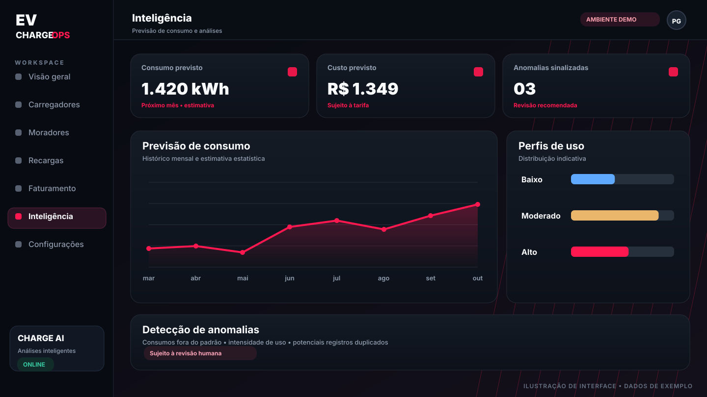

O sistema apresenta **previsão de consumo**, agrupamentos de perfis e detecção de ocorrências fora do padrão. A previsão utiliza histórico mensal e um método estatístico selecionado conforme a quantidade de meses disponíveis. São **estimativas indicativas**, não garantias de demanda futura.

**Na interface:** gráficos Recharts e indicadores visuais, em vez da exibição crua de JSON.

### 09 · Copiloto ChargeAI

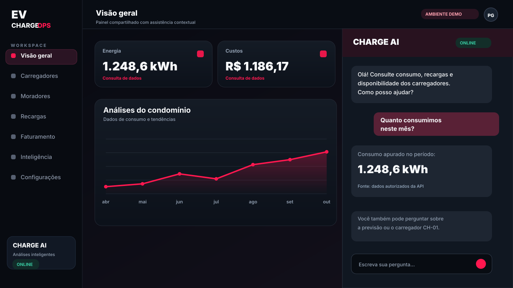

O **ChargeAI** fica na lateral do dashboard e recebe perguntas em linguagem natural sobre consumo, custos, recargas, faturas, disponibilidade, carregadores e previsões. No modo local utiliza **intenções e consultas determinísticas**. Há opção de provedor de linguagem externo para reformular respostas fundamentadas em dados previamente autorizados.

**Exemplos de perguntas:**

```text
Quanto o condomínio consumiu neste mês?
Qual carregador está disponível?
Quanto consumiu o CH-01?
Qual é a previsão de energia para o próximo mês?
Quais são as anomalias detectadas?
```

As **ações suportadas** exigem confirmação explícita, com nova validação de identidade e permissão no backend. O copiloto não recebe acesso direto a SQL nem autoridade irrestrita sobre carregadores físicos.

[Documentação detalhada do ChargeAI](README_COPILOTO.md)

### 10 · Sincronização entre perfis

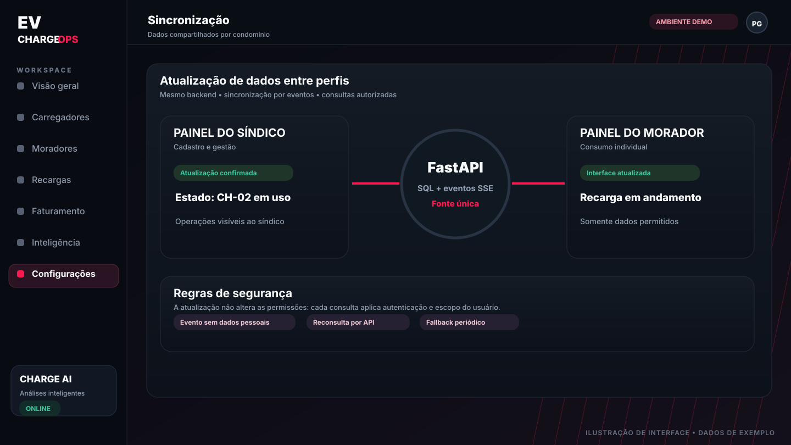

Uma alteração confirmada na API publica um **evento SSE** para os clientes conectados ao mesmo condomínio. As telas reconsultam **seus próprios endpoints autorizados**. Há fallback periódico de **15 segundos** e atualização ao retornar à aba, contribuindo para que ambos os perfis enxerguem o estado mais recente sem compartilhar dados privados indevidamente.

### 11 · OCPP 1.6J e RFID

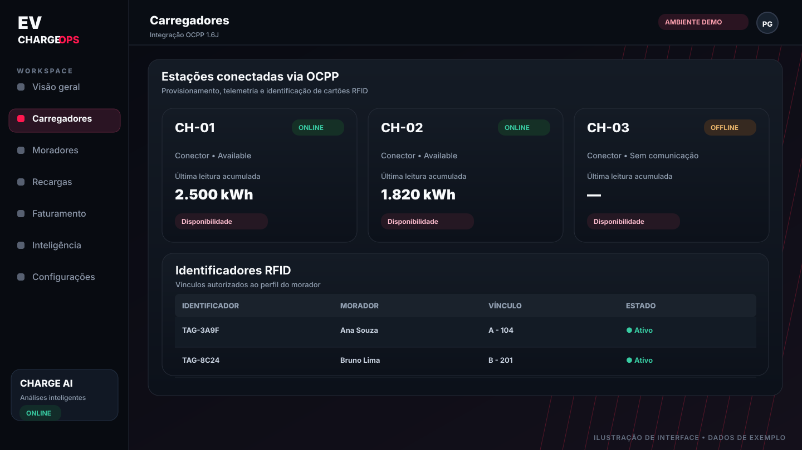

A implementação inclui gateway **OCPP 1.6 JSON via WebSocket** para equipamentos provisionados individualmente, recebimento de mensagens de inicialização, heartbeat, estado do conector, autorização, início, leitura e encerramento de transações. Também inclui cartões RFID por morador e solicitação administrativa de `ChangeAvailability` quando o equipamento está conectado.

**Suporte parcial:** não contempla OCPP 2.0.1, `RemoteStartTransaction`, `RemoteStopTransaction`, Smart Charging ou homologação física de um modelo GoodWe específico. Consulte antes de conectar um carregador real.

**[Abrir documentação OCPP completa →](docs/OCPP.md)**

### 12 · Visão de sustentabilidade

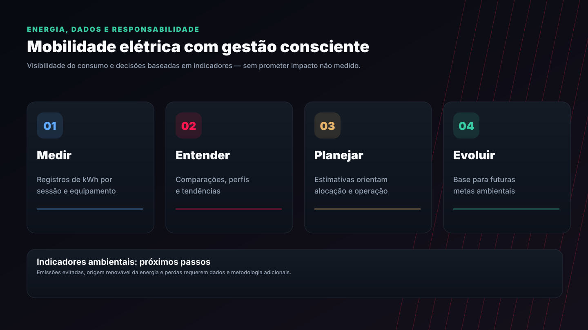

A principal contribuição demonstrável hoje é a **visibilidade operacional da energia**: consumo por sessão, equipamentos, custos, histórico e tendências. Esses dados podem apoiar uso consciente da infraestrutura e decisões futuras sobre horários, dimensionamento e integração com geração renovável — mas o projeto **ainda não calcula emissões evitadas ou comprova economia ambiental real**.

**[Ver proposta de melhoria sustentável →](docs/SUSTENTABILIDADE.md)**

---

## Arquitetura da solução

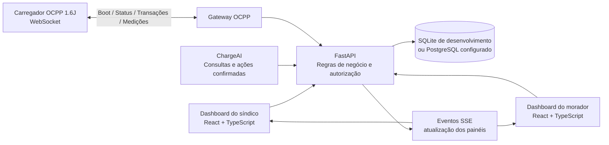

### Stack tecnológica

| Camada | Tecnologias e responsabilidade |
|---|---|
| Interface | React 19, Vite 6, TypeScript, Tailwind CSS e Lucide Icons |
| Gráficos | Recharts — indicadores, histórico e previsões |
| API | Python, FastAPI, Pydantic e autenticação JWT |
| Persistência | SQLAlchemy; SQLite por padrão em desenvolvimento, PostgreSQL configurável |
| Dados e inteligência | scikit-learn, análises estatísticas, intenção local e provedor opcional de LLM |
| Sincronização | SSE (`/api/events`) + atualização de segurança periódica |
| Integração de equipamento | OCPP 1.6J, JSON/WebSocket, autenticação Basic por estação |
| Exportação | CSV para sessões e ReportLab para PDFs de faturas |
| Qualidade | Testes pytest para API, OCPP, faturamento e IA |

### Organização do repositório

```text
SPRINT_2_FIAP_GOODWE/
├── README.md                     # Apresentação geral
├── README_COPILOTO.md            # Detalhamento do ChargeAI
├── README_SYNC_OCPP.md           # Notas originais da etapa OCPP
├── docs/
│   ├── OCPP.md                   # Guia especializado do protocolo
│   ├── SUSTENTABILIDADE.md       # Contribuições e melhorias propostas
│   └── assets/                   # Artes e mockups ilustrativos
├── backend/
│   ├── app/
│   │   ├── api/routes/           # Rotas FastAPI
│   │   ├── ai/                   # ChargeAI, anomalias e previsões
│   │   ├── models/               # Modelos de dados
│   │   ├── services/             # Negócio, OCPP e sincronização
│   │   ├── main.py               # Aplicação e roteamento
│   │   └── seed.py               # Dados de desenvolvimento
│   ├── scripts/ocpp_simulator.py
│   ├── tests/
│   └── requirements.txt
├── frontend/
│   ├── public/login-ev-car.webp  # Imagem de login do projeto
│   ├── src/
│   │   ├── Copilot.tsx
│   │   ├── OcppPanel.tsx
│   │   ├── live.ts
│   │   ├── main.tsx
│   │   ├── api.ts
│   │   └── index.css
│   └── package.json
└── .env.example
```

---

## Executando o projeto

### Requisitos

- Python **3.11 ou superior** (ambiente local validado conforme dependências instaladas).
- Node.js moderno, com npm (recomenda-se uma versão LTS compatível com Vite 6).
- Git e um terminal PowerShell, Bash ou equivalente.
- Banco SQLite para iniciar rapidamente; PostgreSQL é opcional e exige configuração.

### 1. Clone e inicie a API

```powershell
git clone https://github.com/PedroGesini/SPRINT_2_FIAP_GOODWE.git
cd SPRINT_2_FIAP_GOODWE\backend
python -m venv .venv
.\.venv\Scripts\Activate.ps1
python -m pip install -r requirements.txt
python -m uvicorn app.main:app --reload --port 8000
```

Após iniciar o backend uma vez (para criar as tabelas em `development`), **somente se o banco estiver vazio**, execute em outro terminal na pasta `backend/`:

```powershell
python -m app.seed
```

O backend estará disponível em **http://127.0.0.1:8000/docs**.

> [!CAUTION]
> **Não execute** comandos `--reset` em um banco com dados que deseja manter. Não publique `.env`, arquivos de banco, chaves, tokens, senhas nem credenciais de carregadores. A raiz `.env.example` contém um `DATABASE_URL` de **PostgreSQL** como exemplo; caso esteja usando SQLite local, mantenha a configuração padrão da aplicação ou ajuste a variável adequadamente.

### 2. Inicie o frontend

Abra outro terminal, mantendo o FastAPI em execução:

```powershell
cd SPRINT_2_FIAP_GOODWE\frontend
npm install
npm run dev
```

Acesse **http://localhost:5173**. Em desenvolvimento, o Vite encaminha as chamadas `/api` para o backend na porta `8000`.

### 3. Build e testes

```powershell
# Dentro da pasta frontend/
npm run build
```

```powershell
# Dentro da pasta backend/
python -m pytest tests -q
```

Para testes específicos do protocolo:

```powershell
python -m pytest tests\test_ocpp.py -q
```

> Este README descreve o que o código oferece, e **não** afirma homologação física ou execução bem-sucedida de toda a suíte em produção. Confira o ambiente, os resultados dos testes e os logs antes de uma implantação real.

---

## Segurança, testes e limitações

| Área | Medida e situação |
|---|---|
| Autenticação | JWT e validação no backend; contas de demonstração somente para desenvolvimento |
| Escopo de dados | Isolamento por condomínio; sessões/faturas do morador limitadas ao usuário autorizado |
| Ações via IA | Proposta, confirmação e revalidação das permissões antes da execução |
| OCPP | Credenciais individuais, handshake WebSocket, subprotocolo `ocpp1.6` e RFID provisionado |
| Sincronização | Eventos SSE sem dados privados; reconsulta com JWT |
| Pagamentos | Registro e cálculo demonstrativos; **não** é um gateway de pagamento |
| Comandos físicos | `ChangeAvailability` implementado; outros comandos remotos fora do escopo atual |
| Produção | Requer TLS/WSS, migrações, monitoramento, backups, gestão de segredos e homologação física |

### Status do projeto

**Protótipo acadêmico em evolução.** O frontend e o backend contêm os módulos apresentados, mas a compatibilidade com diferentes firmwares GoodWe, a segurança de produção e o funcionamento em infraestrutura multiworker **ainda exigem validação específica**.

### Próximos passos possíveis

- Homologar hardware e firmware OCPP 1.6J suportados.
- Criar migrações de banco e observabilidade de produção.
- Implementar monitoramento de perdas, eficiência e disponibilidade histórica.
- Estudar carregamento inteligente e agendamento por horário de tarifa (não implementados).
- Criar métricas ambientais auditáveis com fator de emissão e origem da energia.
- Evoluir testes ponta a ponta e documentação de implantação.

---

## Contexto do projeto

Desenvolvido como projeto acadêmico no contexto do desafio **FIAP / GoodWe**, relacionando desenvolvimento de software, mobilidade elétrica, automação, dados e possibilidades de melhoria na gestão energética.

**Repositório:** https://github.com/PedroGesini/SPRINT_2_FIAP_GOODWE

<div align="center">

---

**EV ChargeOps — transformar dados de recarga em informação útil.**

*Gestão · Energia · Inteligência · Interoperabilidade*

</div>
