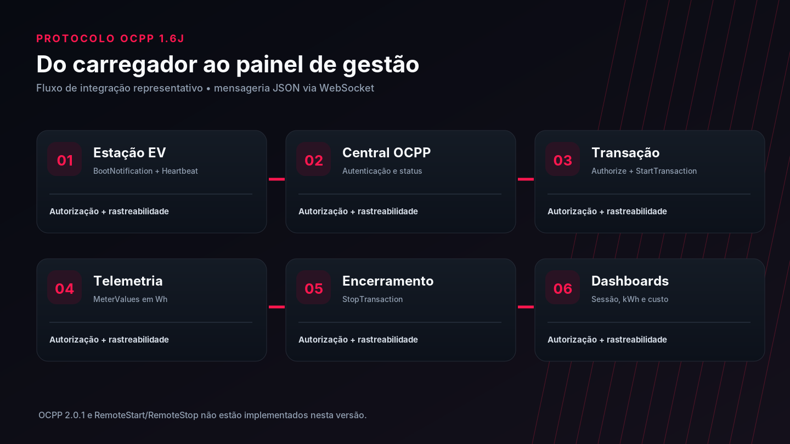
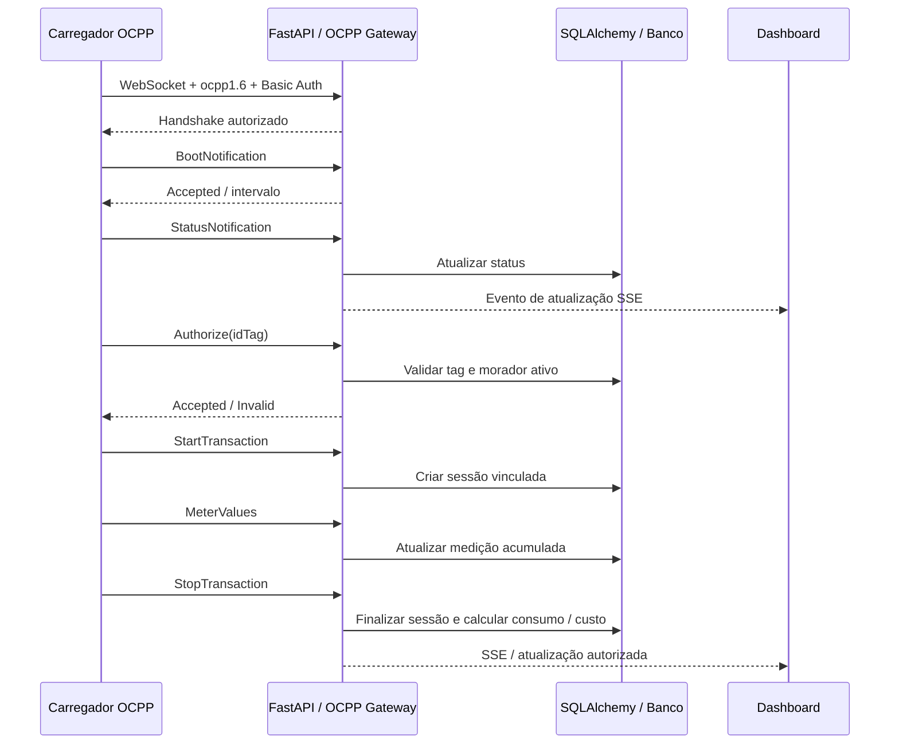
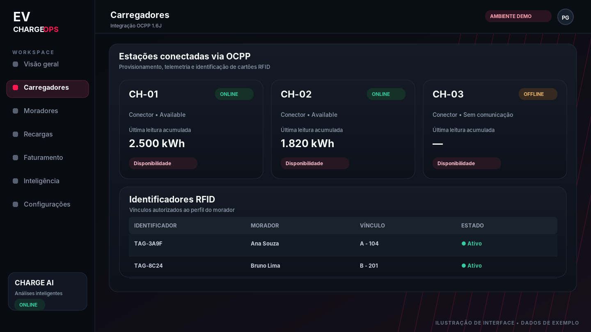

<div align="center">

# OCPP 1.6J — Integração de carregadores

### Documentação dedicada de conectividade, autenticação, telemetria e transações

[](#mensagens-ocpp-suportadas) [](#visão-geral) [](#requisitos-para-um-ambiente-real)

[← README principal](../README.md) · [Soluções sustentáveis](SUSTENTABILIDADE.md)

</div>



> [!IMPORTANT]
> **Estado da implementação:** gateway **OCPP 1.6 JSON**, com suporte ao conjunto de mensagens abaixo. Este repositório não declara homologação com carregador físico GoodWe. Modelo, firmware, autenticação e compatibilidade do dispositivo devem ser verificados separadamente. OCPP **2.0.1 não é suportado**. A arte acima é ilustrativa.

## Visão geral

**OCPP — Open Charge Point Protocol** é um protocolo de interoperabilidade entre uma **estação de recarga** (Charge Point) e um **sistema central** (Central System). Nesta aplicação, o central é implementado no backend FastAPI, via **JSON/WebSocket** no caminho:

```text
wss://SEU-DOMINIO/ocpp/CH-01
```

Em laboratório isolado, a conexão pode utilizar:

```text
ws://127.0.0.1:8000/ocpp/CH-01
```

> `ws://` sem TLS destina-se **somente a testes locais**. Em rede externa, use `wss://` com certificado válido e configuração de rede apropriada.

O endpoint **`/ocpp/{ocpp_id}` é WebSocket**; endpoints administrativos e o painel utilizam, separadamente, rotas HTTP sob **`/api/ocpp/...`**.

## Responsabilidades do servidor



## Mensagens OCPP suportadas

| Mensagem | Direção principal | O que a aplicação faz |
|---|---|---|
| `BootNotification` | Estação → Central | Registra fabricante, modelo e firmware; retorna intervalo e decisão de aceitação |
| `Heartbeat` | Estação → Central | Registra último contato e informa hora UTC |
| `StatusNotification` | Estação → Central | Registra condição reportada pelo conector |
| `Authorize` | Estação → Central | Confere tag RFID provisionada e morador ativo no condomínio |
| `StartTransaction` | Estação → Central | Cria uma sessão `integration` vinculada ao morador identificado |
| `MeterValues` | Estação → Central | Salva leituras cumulativas em energia e atualiza o consumo parcial |
| `StopTransaction` | Estação → Central | Finaliza a sessão com leitura final e custo calculado conforme a tarifa ativa |
| `ChangeAvailability` | Central → Estação | Solicita `Operative` ou `Inoperative` com confirmação administrativa |

**Não implementados nesta versão:** OCPP 2.0.1, `RemoteStartTransaction`, `RemoteStopTransaction`, `SetChargingProfile`/Smart Charging, reservas, atualização remota de firmware, OCPI e certificados por dispositivo. O retorno **`Accepted` de `ChangeAvailability` não prova que o estado físico já mudou**: aguarde `StatusNotification`.

## Configuração de uma estação

1. Entre como **síndico**.
2. Abra **Carregadores → Integração OCPP 1.6J**.
3. Crie a estação no inventário, se ainda não existir.
4. Clique em **Provisionar** e registre o **ID OCPP, usuário e senha**. A senha é exibida somente uma vez.
5. No carregador, configure o endereço WebSocket, subprotocolo **`ocpp1.6`** e autenticação **HTTP Basic** com a credencial específica do equipamento.
6. Faça a estação iniciar a comunicação (`BootNotification`, `Heartbeat` e `StatusNotification`).
7. Cadastre um **ID RFID** válido para o morador antes de iniciar uma transação real.



### RFID e identidade do morador

O backend autoriza o identificador vinculado a um morador **ativo** do mesmo condomínio. O painel permite cadastrar/desvincular tags. O identificador lógico `U{id}` existe para desenvolvimento/teste: **não é um substituto de cartão RFID real em produção**.

### Regras de operação

- Equipamento provisionado exige credencial válida e subprotocolo `ocpp1.6`.
- Sessões integradas usam medições recebidas do dispositivo; não devem ser encerradas artificialmente como uma recarga simulada.
- Equipamentos desconectados são considerados indisponíveis para fins de contagem operacional.
- `ChangeAvailability` só é solicitado ao equipamento conectado e após confirmação administrativa.
- Quando não há `StopTransaction` após queda de conexão, a sessão aguarda reconciliação: **não se inventam leituras finais, duração nem cobrança**.

## Teste usando o simulador

**Pré-requisitos:** projeto instalado, backend em execução, estação de teste provisionada e uma idTag autorizada.

```powershell
cd backend
python -m pip install -r requirements.txt
python scripts\ocpp_simulator.py --url ws://127.0.0.1:8000/ocpp/CH-01 --tag U2 --hold 60
```

Substitua **`CH-01`** pelo ID provisionado e **`U2`** por uma tag de teste realmente autorizada. O script solicita a senha do equipamento. Na demonstração documentada pelo projeto, o simulador usa leituras **1.000 Wh → 3.500 Wh**, totalizando **2,500 kWh**; esse resultado **não é uma medição de hardware físico**.

**Teste automatizado:**

```powershell
cd backend
python -m pytest tests\test_ocpp.py -q
```

## Rotas administrativas

| Método | Rota | Uso |
|---|---|---|
| `GET` | `/api/ocpp/devices` | Consultar estações provisionadas e status |
| `POST` | `/api/ocpp/chargers/{id}/provision` | Criar credencial OCPP |
| `POST` | `/api/ocpp/chargers/{id}/rotate` | Rotacionar credencial |
| `POST` | `/api/ocpp/chargers/{id}/availability` | Solicitar alteração remota de disponibilidade |
| `GET` | `/api/ocpp/tags` | Consultar tags (perfil autorizado) |
| `POST` | `/api/ocpp/tags` | Vincular RFID a morador |
| `DELETE` | `/api/ocpp/tags/{tag_id}` | Remover vínculo RFID |
| `GET` | `/api/ocpp/my-tag` | Consultar identificação lógica para testes autorizados |
| `WS` | `/ocpp/{ocpp_id}` | Conexão de estação OCPP |

As rotas administrativas exigem JWT e perfis/escopos autorizados; a conexão da estação possui autenticação própria.

## Requisitos para um ambiente real

> [!WARNING]
> Não conecte carregadores de clientes a uma instância de desenvolvimento com contas demonstrativas, configuração padrão de segredo JWT, banco sem backup ou WebSocket público sem TLS.

É necessário, no mínimo:

- **TLS/WSS**, certificado válido, firewall e gestão dos segredos por dispositivo.
- Homologação do **modelo e firmware**, compatibilidade da versão OCPP e do método de autenticação.
- Migrações SQL revisadas e backup operacional; a criação automática de tabelas é restrita a desenvolvimento.
- Monitoramento, métricas de erro, timeout, tentativas, idempotência, recuperação de sessões e reconciliação de telemetria.
- Broker distribuído para OCPP e **Redis/pub-sub** caso a plataforma opere com múltiplos workers ou instâncias; o registro de conexões atual é **em memória**.
- Política de segurança para comandos remotos, trilha de auditoria e limites operacionais.

## Onde encontrar a implementação

| Arquivo | Finalidade |
|---|---|
| [`backend/app/services/ocpp_gateway.py`](../backend/app/services/ocpp_gateway.py) | Comunicação OCPP e processamento de mensagens |
| [`backend/app/api/routes/ocpp.py`](../backend/app/api/routes/ocpp.py) | Provisionamento e comandos administrativos |
| [`backend/app/models/ocpp.py`](../backend/app/models/ocpp.py) | Persistência de equipamentos, medidores e tags |
| [`backend/scripts/ocpp_simulator.py`](../backend/scripts/ocpp_simulator.py) | Simulador para laboratório |
| [`frontend/src/OcppPanel.tsx`](../frontend/src/OcppPanel.tsx) | Interface administrativa de OCPP/RFID |
| [`README_SYNC_OCPP.md`](../README_SYNC_OCPP.md) | Notas da implementação da etapa de sincronização |

---

[← Voltar ao README principal](../README.md)
